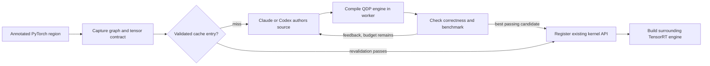

# Agentic region kernel generation

## Objective

Users mark a functional region in their PyTorch model. During Torch-TensorRT
compilation, an agent generates a Triton or NVIDIA cuTile kernel for that region.
The compiler evaluates candidates, retains the fastest correct implementation,
and registers it through the existing Quick Deployable Plugin (QDP) APIs.
Inference executes the TensorRT engine without an agent or a Python kernel launcher.

This design borrows Mosca's separation of **author** and **executor**. It does not
depend on Mosca, its benchmark catalogue, its storage service, or its scheduler.

## Public interface

```python
import torch
from torch_tensorrt import region as regions

generator = regions.KernelGenerator(provider="claude", backend="triton")

class Model(torch.nn.Module):
    def forward(self, x, bias, scale):
        x = x + 1
        with regions.fused_kernel(generator=generator, name="activation"):
            x = torch.relu(x + bias) * scale
        return x - 0.5
```

Use `provider="codex"` for the installed Codex CLI, or `backend="cutile"` for
NVIDIA cuTile. Log into the selected CLI beforehand using its normal account
workflow. The integration reuses that login and accepts an optional model name;
it does not copy credentials or require a separate API key. Model calls consume
the configured account's allowance. The captured computation and tensor metadata
are included in the model request.

Outside an owned strict Dynamo compilation, the annotation runs its original
PyTorch body. Existing handwritten `kernel=` annotations continue to work.
Exactly one of `kernel=` and `generator=` must be supplied.

## Run the example

The complete example is
[`examples/dynamo/agentic_region_kernel_generation.py`](examples/dynamo/agentic_region_kernel_generation.py).
It contains only PyTorch operations and an annotation; it contains no handwritten
kernel or registration callback.

```bash
codex login
python examples/dynamo/agentic_region_kernel_generation.py --provider codex
python examples/dynamo/agentic_region_kernel_generation.py --provider codex --backend cutile
```

For Claude, complete its normal CLI login and use `--provider claude`. Optional
arguments are `--model`, `--attempts`, `--timeout`, and `--cache-dir`. The example
defaults to three author attempts and a 600-second search budget per region.
Running the same command again avoids author calls when cache revalidation passes.
It prints the final engine's layer list and checks the surrounding model against
PyTorch on fresh and nonfinite inputs.

Use a Torch-TensorRT build with QDP support. Triton follows the existing
`triton_op` prerequisites. cuTile follows `cutile_op`: CUDA Toolkit and loaded
driver 13.2 or later, a compatible tileiras compiler, and `cuda-tile>=1.3`.
Installing a toolkit alone does not upgrade the loaded driver. Generation checks
the selected cuTile toolchain before spending an agent request.

## Compile-time workflow

1. Capture the annotated operations using the existing region markers and HOP.
2. At region materialization, derive the static input/output contract and a
   reproducible reference graph. The user-selected region remains one task.
3. Look up a cache entry bound to the computation, constants, tensor contract,
   target GPU, toolchain, backend, and validation settings.
4. On a miss, send an author request containing the reference graph, tensor
   contract, kernel interface, target, remaining budget, and previous results.
5. The author returns JSON containing one kernel's source, entry point,
   compile-time constants, grid, and supported compiler options.
6. Validate the proposal, then evaluate it in a separate process. The executor
   imports the kernel, registers it using the existing kernel API, builds a
   TensorRT engine, and checks fresh inputs against the captured PyTorch graph.
7. Benchmark passing candidates with compilation and warmup outside timing.
   Return actual errors and measurements to the next author call. Retain the
   fastest passing candidate, even if subsequent attempts fail or regress.
8. Cache the accepted proposal and its evidence. Register it in the owning
   compilation through the existing region plugin machinery.



Generation is bounded by a per-region wall-time search budget, attempt count, and
per-candidate evaluation timeout. A failure to produce a correct candidate raises a region compilation
error; it never silently substitutes eager execution for an explicitly requested
plugin. A passing candidate is not a guarantee of beating native TensorRT. The
example also validates the completed surrounding model.

## Agent integration

The provider adapter invokes a noninteractive Claude or Codex subprocess. The
prompt is passed on stdin; source code is returned as structured output. Agents
author proposals; they do not choose tolerances, modify the reference, or report
their own successful benchmark result. There is no shell command generated by
the model in the kernel proposal.

Each attempt receives the original task, the three most recent feedback entries,
and the fastest passing candidate if it is older. This bounds repeated source
content while retaining the incumbent. The complete history remains on disk,
independent of provider session formats. CLI errors,
malformed replies, compiler errors, numerical mismatches, and timings remain
distinct outcomes. Processes and their descendants are terminated on timeout.
Unavailable CLIs and account/configuration errors stop further author requests;
an earlier passing candidate is still retained.

Official provider references:

- [Codex noninteractive execution](https://learn.chatgpt.com/docs/non-interactive-mode)
- [Claude programmatic execution](https://code.claude.com/docs/en/headless)

## Kernel contract and reuse

The first implementation targets functional regions with static, contiguous CUDA
float32, float16, or bfloat16 tensor boundaries. Each proposal implements one
kernel. Inputs are named `arg0`, `arg1`, etc.; outputs are `out0`, `out1`, etc.
The CLI and worker process management currently requires a POSIX host.
All tensor arguments precede named compile-time constants. Static sizes are
constants, so generated Triton kernels need no runtime scalar argument callbacks.
cuTile arrays use the existing flattened rank-one interface.
Dynamic shapes, noncontiguous boundaries, mutation, random operations, nested
regions, and multi-kernel proposals are outside this first implementation.
Tensor constants must be lifted into the region's inputs; remaining tensor
attributes are rejected because the author would not have their values.

The executor derives pointer types and compiler-produced launch facts. The author
chooses source, grid, constants, and applicable tuning options. It supplies no
Python allocation wrapper, arbitrary host callback, or additional kernel launches.

Reuse `kernels.triton_op` and `kernels.cutile_op`, including their PTX compilation,
ABI checks, QDP registration, and target validation. No new `PluginSpec` is needed.
The generator configuration describes the search, not a second kernel-registration
format. The JSON proposal is a persisted author response.

## Validation and artifacts

The trusted evaluator owns independently seeded numerical checks, additional zero
and sign cases, optional nonfinite cases, input mutation checks, and CUDA-event
timing. The evaluated graph must contain a TensorRT engine with the generated
plugin. Reference and candidate use identical inputs and output contracts.
Timing uses CUDA graph replay after warmup, with multiple invocations per graph
and the median of five samples. Reference work is timed before and after the
candidate. These are GPU execution measurements for the isolated region, not
end-to-end application latency or a comparison with a native TensorRT region.

Candidate code is restricted to the selected DSL and one decorated function.
Subprocess isolation limits failures and provides timeouts; it is not a hostile-code
security sandbox. Generated code and its compiler should run in a trusted GPU
development environment. Source and result artifacts are retained for inspection.

Cache entries include a content digest and validation policy. Corrupt or incompatible
entries are regenerated. Cache files are published atomically; per-key locking avoids
duplicate generation across concurrent compilations. Cached kernels are validated
again before use, without a model call.

Within one generation run, identical passing candidates reuse their measured
results instead of launching another evaluator. Candidate identity includes both
source and launch settings, so tuning the grid, constants, or compiler options
still triggers fresh evaluation. Failed evaluations remain eligible for retry.

The default cache is `$XDG_CACHE_HOME/torch_tensorrt/region_kernels`, or
`~/.cache/torch_tensorrt/region_kernels`. Each task key contains:

- `accepted.json`: chosen source, launch settings, content digests, and the path
  to the original evaluation evidence.
- `run-*/task.json` and `reference.pt`: the executor's task and reference.
- `run-*/*.py`: the selected generated source; its exact path is logged.
- `run-*/attempt-*/`: prompt, accepted-shape proposal, worker log, and feedback.
- `run-*/history.json`: the complete candidate and feedback history.
- `run-*/cache_check.json`: fresh validation results on cache reuse.

Deletion of this cache causes regeneration on the next compilation. It does not
change an already built engine. The inference engine contains the compiled
plugin code; provider CLIs are used only when compiling an uncached region.

## Implementation

The public annotation stores generator configuration in its compilation session.
The internal generation package owns provider calls, source validation, the worker,
feedback, and caching. `materialize_regions()` resolves generation before calling
`register_region_plugin()`.

### Automated checks

The new tests use scripted authors, so they need no account or paid model requests:

- `test_generation_providers.py`: CLI arguments, structured replies, permanent
  failures, diagnostic redaction, and descendant cleanup on timeout.
- `test_generation_candidates.py`: source restrictions, launch configuration,
  parameter ordering, and reuse of existing registration APIs.
- `test_kernel_generation.py`: public capture behavior, feedback, selection,
  cache invalidation, failures, and budgets.
- `test_generation_worker.py`: output/mutation checks and isolated GPU tests that
  accept a correct multi-output kernel and reject an incorrect one.
- `test_generation_integration.py`: complete annotated compilation and cache reuse
  for both DSLs and all three supported floating-point boundary dtypes.

These tests live under `tests/py/dynamo/regions`. Run the region suite and the
affected kernel frontend tests sequentially to avoid competing GPU benchmarks:

```bash
python -m pytest tests/py/dynamo/regions \
  tests/py/kernels/test_triton_op.py tests/py/kernels/test_cutile_op.py \
  tests/py/kernels/test_kernel_dtype_safety.py \
  tests/py/kernels/test_kernel_schema_safety.py -q -n0
```
