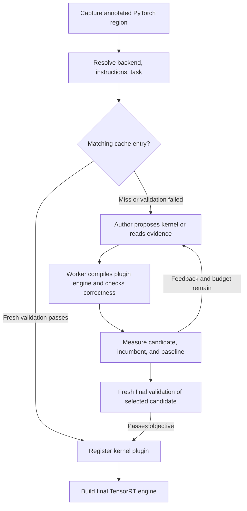

# Agentic region kernel generation

Users mark a functional region in their PyTorch model. During compilation, an
agent proposes a GPU kernel, and Torch-TensorRT compiles, checks, and measures it.
The selected kernel becomes a Quick Deployable Plugin (QDP) in the final
TensorRT engine. Inference runs the compiled engine without an agent.

The design borrows Mosca's separation of the author, reusable instructions, and
independent executor. It uses Torch-TensorRT's own compiler and evaluator, with
no dependency on a Mosca checkout or service.

## Configure the author and kernel language separately

```python
import torch
from torch_tensorrt import region as regions

generator = regions.KernelGenerator(
    provider="claude",
    backend="cutile",
    instructions="Prioritize coalesced loads for the broadcasted inputs.",
    instruction_files=("kernel-guidance.md",),
    objective="tensorrt",
    min_speedup=1.05,
)

class Model(torch.nn.Module):
    def forward(self, x, bias, scale):
        x = x + 1
        with regions.fused_kernel(generator=generator, name="activation"):
            x = torch.relu(x + bias) * scale
        return x - 0.5
```

`provider` chooses who writes the proposal: the installed, logged-in Claude or
Codex CLI. `model=None` keeps the provider's configured default. Model requests
contain the captured graph, tensor metadata, selected guidance, and feedback;
they use the configured provider's account allowance.

`backend` chooses the generated code and the adapter that compiles it:

| Backend | Generated code | Compilation and registration |
| --- | --- | --- |
| `triton` | One Triton JIT function | Existing `triton_op` path |
| `cutile` | One NVIDIA cuTile Python kernel | Existing `cutile_op` path |
| `cuda_cpp` | One CUDA C++ global kernel | CUDA Python `cuda.core`/NVRTC and QDP |

Here, CUDA Python supplies the compiler interface for CUDA C++ source. Numba
CUDA kernels and CuTe DSL are not built-in backends. Supporting another language
requires its own executable backend adapter, not just different prompt wording.

Use direct `torch_tensorrt.compile(..., ir="dynamo", strict=True,
offload_module_to_cpu=False)` capture. Eager execution runs the original PyTorch
body. Existing handwritten `kernel=` annotations still work; supply exactly one
of `kernel=` and `generator=`.

## Follow the compilation pipeline

1. **Capture the region.** Preserve its operations as a reference graph and
   derive the input/output tensor contract.
2. **Resolve the backend and instructions.** Load its schema, toolchain metadata,
   shared author skill, backend guide, and explicit user guidance.
3. **Check the cache.** A matching candidate receives fresh validation and must
   still meet the configured performance objective.
4. **Request a proposal.** Send the task, remaining budget, recent results, and
   current incumbent. The author can request bounded pages of named evidence
   before returning source and backend-specific launch settings.
5. **Evaluate in a worker.** Validate the source and launch contract, build a
   trial TensorRT engine containing the plugin, compare outputs against PyTorch,
   and check that inputs were not modified.
6. **Measure and revise.** Interleave repeated measurements of the candidate,
   reference, incumbent when present, and selected baseline. Feed actual failures
   and measurements into the next proposal. Retain the incumbent when the
   apparent improvement is within measured noise.
7. **Confirm the winner.** Run a separate final evaluation with fresh random
   inputs. Correctness and the performance objective must both pass.
8. **Finish compilation.** Register the accepted kernel through the existing
   plugin machinery, then build the surrounding TensorRT engine normally.



`max_attempts` limits proposals. Each proposal has an `author_timeout_s` allowance
including at most `max_context_requests` evidence reads. `candidate_timeout_s`
bounds each worker evaluation, and `timeout_s` bounds the whole search. The
controller reserves evaluation time and terminates subprocess descendants on
timeout. A failure to produce an accepted kernel raises `RegionError`.

## Instructions, skills, and controlled evidence

The canonical skill ships inside the Python package at
`_generation/skills/kernel-author/SKILL.md`. Its references describe correctness,
evaluation feedback, and each built-in backend. The loader selects only the
shared and chosen backend resources through `importlib.resources`, so installed
wheels do not depend on repository paths.

`instructions` adds inline guidance; `instruction_files` adds explicit UTF-8
files. Their exact contents and hashes are saved with the run. Guidance can
change implementation choices, but the backend's schema, tensor ABI, and worker
checks determine what can execute and pass.

The structured author response is one of:

```json
{"action": "read", "candidate": null, "resource": "attempt-1/worker.log", "offset": 0}
```

```json
{"action": "propose", "candidate": {"source": "..."}, "resource": null, "offset": null}
```

The second example abbreviates the backend's required candidate fields. The
controller serves immutable snapshots from its evidence catalog in bounded
pages, with a continuation offset. It records each request and response.
Providers cannot use these reads to browse arbitrary paths or execute commands.
Recent feedback and the incumbent are included directly; full recorded logs and
older attempts remain available by name. Evidence access uses the same response
protocol for Claude, Codex, and custom providers.

The repository's
[Claude Code skill](.claude/skills/torch-tensorrt-kernel/SKILL.md) is a thin entry
point to the same package instructions and controller. Compiler calls load the
canonical resources explicitly; they do not depend on ambient skill discovery.

```bash
python -m torch_tensorrt.dynamo.region_compilation._generation instructions --backend cuda_cpp
python -m torch_tensorrt.dynamo.region_compilation._generation inspect PATH
python -m torch_tensorrt.dynamo.region_compilation._generation generate PATH --provider claude --backend cutile
python -m torch_tensorrt.dynamo.region_compilation._generation evaluate PATH --candidate CANDIDATE_PATH --timeout 120
```

`PATH` identifies a saved run, task, attempt, or accepted manifest. Inspection and
instruction display make no model calls. `generate` reuses the captured task;
`evaluate` sends a candidate through the existing worker with fresh validation
and exits unsuccessfully if validation or the configured objective fails. Saved
references contain trusted Python objects; replay your own trusted artifacts.

## Decide what counts as an improvement

| Objective | Acceptance requirement |
| --- | --- |
| `candidate` (default) | Correctness and selection among generated candidates |
| `eager` | Correctness and the required ratio against the PyTorch region |
| `tensorrt` | Correctness and the required ratio against a fully compiled TensorRT region |

For baseline objectives, `min_speedup` is **baseline latency / candidate latency**.
Acceptance accounts for observed timing variation:

```text
baseline_median - baseline_MAD >= min_speedup * (candidate_median + candidate_MAD)
```

MAD is median absolute deviation. This is a conservative noise allowance, not a
statistical confidence guarantee. For example, `1.05` requires an adjusted ratio
of at least 1.05 during selection, final validation, and cache revalidation. The
default `candidate` objective does not require a baseline speedup.

The worker prepares CUDA graphs outside timing, then records repeated GPU event
measurements. `benchmark_iters` controls invocations per sample;
`benchmark_repeats` controls interleaved samples. Reports retain samples,
medians, and spread. The incumbent is measured alongside a new candidate when
available, rather than relying solely on an old timing number.

Search candidates share validation cases; the selected kernel receives a fresh
holdout evaluation. Checks include random and constant inputs, optional
nonfinite cases, output shape/dtype, and input immutability. These are measured
checks, not a proof for every possible input. Region timing does not establish
whole-model speedup; benchmark the completed model separately.

## Extend a backend or provider

Either selection accepts an explicit `module:attribute` path. The named module
must be importable in worker subprocesses; an in-memory parent-only registry is
insufficient.

A backend object, or a class with a no-argument constructor, implements
`_generation._backends.GenerationBackend`:

| Member | Responsibility |
| --- | --- |
| `name`, `version` | Backend identity and compatibility version |
| `proposal_schema` | JSON schema for its candidate payload |
| `instruction_resources` | Tuple of packaged guidance resources |
| `target_metadata(device)` | Target/toolchain information used in task and cache identity |
| `validate_candidate(proposal, num_inputs, num_outputs)` | Check and normalize source and launch settings |
| `make_registration(candidate, input_specs, output_specs, directory)` | Compile/register through an existing `KernelSpec` or registration callback |

Custom instruction resources can use `package:relative/path.md` to load files
shipped with the extension. Candidate payloads crossing process boundaries must
remain JSON serializable. Backend extensions are trusted compiler code.

A provider extension is a callable or object with `propose()`. Its callable
accepts keyword arguments `model`, `prompt`, `workdir`, `timeout_s`, `schema`, and
`evidence`, or `**kwargs`, and returns a JSON object under the supplied response
schema. It can integrate an SDK or another model service. Custom providers run
in bounded subprocesses; the controller still owns evaluation and selection.

## Cache, evidence, and current limits

Cache identity includes the captured computation, tensor contract, target and
toolchain, backend version, proposal schema, exact instruction bundle,
performance objective, and evaluation policy/version. Changing a guidance file
therefore cannot silently return a result generated under the old guidance.
Accepted entries are published atomically and locked per task; every reuse
receives fresh validation. Identical passing proposals within one search can
reuse their earlier evaluation, followed by the required final holdout.

The default cache is `$XDG_CACHE_HOME/torch_tensorrt/region_kernels`, falling back
to `~/.cache/torch_tensorrt/region_kernels`. Each task contains an `accepted.json`
manifest and run directories with:

- `task.json`, `reference.pt`, and `evaluation-template.json`: the captured task
  and reproducible search inputs/configuration.
- `instructions.json` and `proposal.schema.json`: exact guidance and response contract.
- `attempt-*/`: prompts, source proposals, worker results, and evidence reads.
- `history.json`, `holdout/feedback.json`, and `accepted.json`: selection history
  and final acceptance evidence.
- `cache_check.json`: fresh results when a cached kernel is checked.

Current generation requires POSIX and static, contiguous, nonempty CUDA float32,
float16, or bfloat16 tensor boundaries. Built-in candidates contain one kernel;
inputs precede outputs, and the executor owns allocation and launch. Dynamic
shapes, noncontiguous boundaries, input mutation, random reference operations,
nested regions, and multi-kernel proposals remain unsupported. Tensor constants
must appear as boundary inputs. Subprocess isolation provides failure containment
and timeouts; it is not a hostile-code security sandbox.

## Run the example

Use a Torch-TensorRT build with QDP support and the selected backend's toolchain.
Triton follows `triton_op` prerequisites. cuTile follows `cutile_op`, including a
CUDA Toolkit and loaded driver of 13.2 or later and a matching tileiras compiler.
CUDA C++ requires CUDA Python's `cuda-core`/`cuda-bindings` and NVRTC.

```bash
codex login
python examples/dynamo/agentic_region_kernel_generation.py --provider codex
python examples/dynamo/agentic_region_kernel_generation.py --provider claude --backend cuda_cpp
python examples/dynamo/agentic_region_kernel_generation.py --backend cutile --instruction-file kernel-guidance.md
python examples/dynamo/agentic_region_kernel_generation.py --objective tensorrt --min-speedup 1.05
```

Log into Claude through its normal account flow before selecting it. The example
also accepts `--instructions`, repeated `--instruction-file`, `--model`,
`--attempts`, `--timeout`, and `--cache-dir`. It checks the final model against
PyTorch on fresh and nonfinite inputs and prints the engine's layers.
