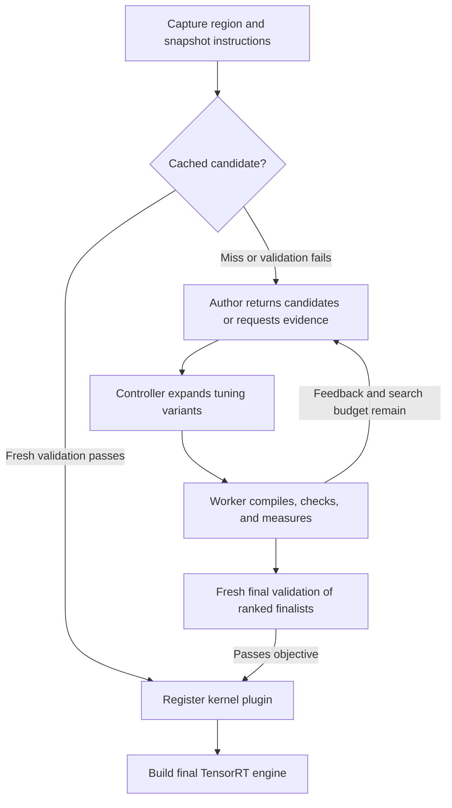

# Agentic region kernel generation

Users mark a functional region with `torch_tensorrt.region.fused_kernel` and a
`KernelGenerator`. During compilation, an agent proposes GPU kernels and
Torch-TensorRT compiles, checks, and measures them. The accepted kernel becomes a
Quick Deployable Plugin (QDP) in the final TensorRT engine. Inference runs the
compiled engine without an agent.

This note records the architecture and design goals. The
[region API documentation](docsrc/py_api/region.rst) describes configuration,
replay commands, and extension contracts. The
[runnable example](examples/dynamo/agentic_region_kernel_generation.py) covers
installation prerequisites and verifies execution inside the completed engine.

## Design goals

- Keep authoring, instructions, and evaluation separate, following the useful
  separation in Mosca while using Torch-TensorRT's own compiler and evaluator.
  There is no dependency on a Mosca checkout or service.
- Let users choose the model provider independently from the kernel language.
  Built-in providers use logged-in Claude or Codex CLIs; built-in backends are
  Triton, NVIDIA cuTile, and CUDA C++ compiled through CUDA Python/NVRTC.
- Let the controller decide acceptance from measured correctness and performance.
  The author can change source and launch settings, but cannot replace the
  evaluator or supply its own acceptance result.
- Make searches bounded, inspectable, and reusable. Save the task, exact
  instructions, proposals, and measured feedback; revalidate a cached winner
  before using it in another compilation.

## Component responsibilities

| Component | Responsibility |
| --- | --- |
| Region capture | Preserve the selected computation and its static tensor contract |
| Generation controller | Own budgets, evidence access, tuning, ranking, resume, and final selection |
| Provider adapter | Return proposals or evidence requests under the supplied response schema |
| Backend adapter | Define candidate syntax, validate launch settings, and compile/register kernels |
| Evaluation worker | Build a trial plugin engine, check outputs and input immutability, and measure execution |
| Existing plugin pipeline | Register the accepted kernel and compile the surrounding TensorRT engine |

Provider and backend extensions use explicit, importable `module:attribute`
adapters. Their contracts and available backend languages are described in the
[API documentation](docsrc/py_api/region.rst); instructions alone cannot add a
compiler or registration path.

## Search and author protocol

`max_attempts` bounds **author rounds**. A round can return up to
`SearchPolicy.batch_size` candidates. The controller can expand each into
bounded launch variants from explicit tuning domains. `max_candidates` limits
actual search evaluations, including tuning, resumed candidates, and requested
diagnostics; its default is `max_attempts * batch_size`. Cache revalidation and
final validation do not consume candidate slots. Final validation reserves time
within the overall search timeout, and `finalists` bounds the ranked alternatives
that can receive that check.

Each author round shares its `author_timeout_s` allowance across proposal calls
and at most `max_context_requests` evidence reads or diagnostic requests.
`candidate_timeout_s` bounds each worker evaluation; `timeout_s` bounds the
search. Resuming restores compatible evidence and remeasures retained candidates
with fresh invocation budgets.

The response envelope contains `action`, `candidate`, `candidates`, `resource`,
and `offset`; unused fields are null. Candidate payloads follow the selected
backend's schema.

| Action | Meaning |
| --- | --- |
| `propose` | Supply one `candidate` or a bounded `candidates` batch |
| `read` | Request a page of a named evidence resource at `offset` |
| `diagnose` | Request a measured diagnostic of the incumbent when diagnostics are enabled |
| `stop` | End authoring; the controller still validates any selected finalist |

Evidence consists of immutable snapshots registered by the controller. Reads
return bounded pages and continuation offsets, and cannot address arbitrary
paths. Diagnostics share both context and evaluation budgets. Existing custom
providers that return a direct single-candidate object remain supported.

## Instructions, acceptance, and replay

The [packaged author skill](py/torch_tensorrt/dynamo/region_compilation/_generation/skills/kernel-author/SKILL.md)
and backend references are loaded with `importlib.resources`, so installed wheels
work without repository paths. Inline guidance and explicit instruction files
are snapshotted with the packaged resources. The
[interactive Claude Code skill](.claude/skills/torch-tensorrt-kernel/SKILL.md)
uses the same instructions and controller.

Candidates share search validation cases. Finalists and cached candidates
receive fresh validation. The `candidate` objective ranks correct generated
kernels; `eager` and `tensorrt` also require the configured speedup against the
corresponding region baseline. Interleaved measurements and a median absolute
deviation allowance reduce sensitivity to timing noise. These checks do not
prove correctness for every input or establish whole-model speedup.

Cache identity binds the captured computation, tensor contract, backend and
toolchain, exact instructions, objective, and evaluation policy. Saved runs
include the reference, task, instruction bundle, per-attempt feedback, and search
history. Replay with the same backend and no guidance override uses the exact
saved instruction bundle; missing or mismatched snapshots fail before execution
when the task records an instruction digest. Legacy tasks without a digest can
load current guidance. Explicit backend or guidance changes start a new bundle.

Current boundaries are static, contiguous, nonempty CUDA float32, float16, or
bfloat16 tensors. Each candidate contains one kernel, and tensor constants must
be boundary inputs. Generated code and extension adapters execute locally;
subprocesses provide timeout and failure containment, not a hostile-code sandbox.
See the [API documentation](docsrc/py_api/region.rst) and
[example](examples/dynamo/agentic_region_kernel_generation.py) for supported
capture settings, toolchain requirements, and commands.
